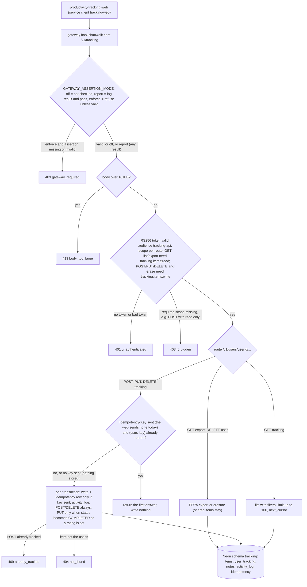

# 01 — Business process (As-Is / To-Be)

productivity-tracking-api คือ Tracking cell: API ที่เก็บข้อมูล tracking ของเว็บ productivity-tracking-web (รายการกลาง, รายการติดตามของแต่ละผู้ใช้, โน้ต, activity log) ผู้เรียกเดียวคือเว็บนั้น ผ่าน gateway ด้วย service client token และแถวข้อมูลรายบุคคล (user_tracking, notes, activity_log, idempotency) ถูกจำกัดเฉพาะผู้ใช้ใน path; รายการกลาง (items) ใช้ร่วมกัน และ `_count.userTrackings` นับผู้ติดตาม item เดียวกันจากทุกผู้ใช้

Last reviewed: 2026-11-27 · commit `d642ae5`

## As-Is (จากโค้ดวันนี้)

Sources: `src/tracking_api/app.py` (`create_app`, `add_tracking`, `update_tracking`, `remove_tracking`, `export_user`, `erase_user`), `src/tracking_api/auth.py`, `src/tracking_api/gateway.py`, `migrations/0001_init.sql`, `README.md`, `AGENTS.md`

ข้อเท็จจริงจากโค้ด:

- POST ใช้ item กลางที่มีอยู่แล้ว (ชื่อ + category แบบไม่สนตัวพิมพ์) ไม่เช่นนั้นสร้าง item ใหม่ แล้วเพิ่มแถวของผู้ใช้; `UniqueViolation` กลายเป็น 409
- `GATEWAY_ASSERTION_MODE` ค่าเริ่มต้น `off`; ค่าที่ production ใช้อยู่ตอนนี้ (report หรือ enforce) [ต้องยืนยัน] เพราะค่าอยู่ใน Railway variables
- deploy ส่งแค่โค้ด ไม่ migrate: เมื่อ PR มี migration ใหม่ ต้องรัน `tracking-db migrate` ก่อน merge (README, AGENTS.md); PR ที่เปลี่ยนเฉพาะโค้ดหรือเอกสารไม่ต้อง
- migration `0001_init.sql` เป็นไฟล์เดียวที่มี; การ import จากตารางเดิมของเว็บทำผ่าน `tracking-db import` (`src/tracking_api/importer.py`)

## To-Be (SPEC-003, productivity-tracking-web, approved 2026-11-12)

เป้าหมายตาม SPEC-003 (อนุมัติและ implement แล้ว 2026-11-12): cell นี้เป็นเจ้าของข้อมูล tracking ทั้งหมดหลัง gateway,
เว็บเก็บแค่ NextAuth sign-in แล้วเรียก cell ด้วย token อายุสั้น; เกณฑ์ยอมรับ AC-01–AC-07:

- AC-03: ทุก create, update และ delete เขียน activity log หนึ่งแถวใน transaction เดียวกัน; replay `Idempotency-Key` เดิมคืนผลแรกและไม่เขียนเพิ่ม
- AC-04: คำขอที่ไม่ผ่าน gateway ได้ 403 (`GATEWAY_ASSERTION_MODE=enforce` หลัง report หนึ่งสัปดาห์); `/health` และ `/readyz` อยู่นอกการตรวจ
- AC-05: list คืนไม่เกิน 100 แถวพร้อม cursor (SPEC เขียน `GET /v1/tracking`; เส้นทางจริงคือ `GET /v1/users/{userId}/tracking`)
- AC-06: PDPA export / erase ครอบคลุม tracking rows, notes และ activity ของผู้ใช้; item กลางที่ผู้ใช้สร้างคงอยู่โดยไม่มี user id

Sources: `bookchaowalit-website/productivity-tracking-web:specs/003-tracking-cell/spec.md` (origin/main `a9bd186`)

## Gap

| ID | As-Is → To-Be | Status | Owner | Evidence |
|---|---|---|---|---|
| G1 | PUT เขียน activity log เฉพาะเมื่อเปลี่ยนเป็น COMPLETED หรือตั้ง rating; แก้เฉพาะ `progress` ไม่มีแถว log → ทุก update เขียน log หนึ่งแถว (AC-03) | todo | claude | `src/tracking_api/app.py` (`update_tracking`); SPEC-003 AC-03 |
| G2 | `GATEWAY_ASSERTION_MODE` ค่าเริ่มต้น `off`, ค่าบน production ไม่เห็นจากโค้ด [ต้องยืนยัน] → `enforce` หลัง report หนึ่งสัปดาห์ (AC-04) | todo | owner | `README.md`; SPEC-003 AC-04 |

## Open questions

- `GATEWAY_ASSERTION_MODE` ใน production เป็น report หรือ enforce (README เขียนว่า report ก่อนแล้ว enforce) [ต้องยืนยัน]
- SPEC-003 อยู่ใน repo productivity-tracking-web ไม่ได้อยู่ที่นี่ (อ้างอิงเป็น To-Be ข้าม repo)
